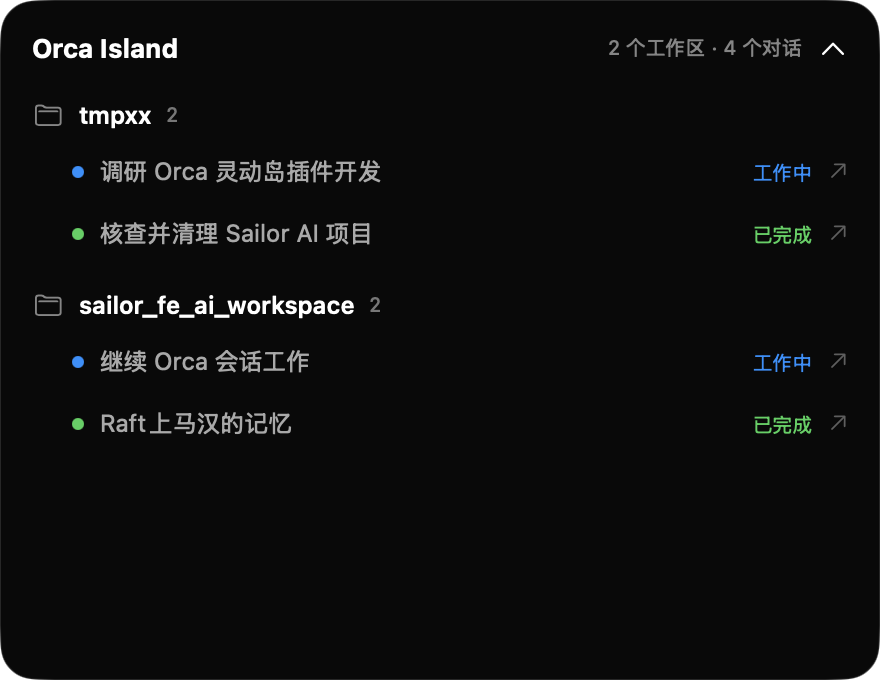

# Orca Island

把 Orca 的智能体状态放到 macOS 刘海灵动岛：按工作区分组显示运行中的对话、终端标题和状态，点击对话可以跳回 Orca 终端。



## 使用

1. 构建并启动灵动岛：

   ```bash
   ./scripts/build-companion.sh
   open dist/OrcaIsland.app
   ```

2. 在 Orca → Settings → Plugins 中打开插件系统。
3. 添加这个仓库目录作为 Development folder，然后 Review & Enable：

   ```text
   /path/to/orca-island
   ```

灵动岛每 2 秒读取 Orca 的终端和 Agent 状态。插件启用后，会通过 `agent.status.changed` 实时更新。

## 开发

```bash
node --test tests/main.test.mjs
swift build --package-path companion
```

插件入口是根目录的 [`orca-plugin.json`](orca-plugin.json) 和 [`main.mjs`](main.mjs)。
