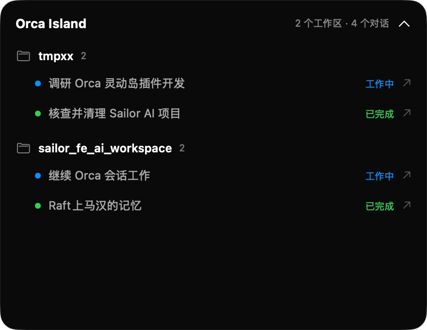

# Orca Island

把 Orca 的智能体状态放到 Mac 顶部灵动岛。按工作区分组，显示每个对话的终端标题和运行状态，点击对话即可跳回对应的 Orca 终端。



[查看原图](https://github.com/TwitterIsGood/orca-island/blob/main/artifacts/orca-island-preview.jpg)

## 怎么用

需要 macOS 13+、Orca 1.4.245+ 和 Xcode Command Line Tools（提供 Swift 编译器）。

1. 下载、构建并启动：

   ```bash
   git clone https://github.com/TwitterIsGood/orca-island.git
   cd orca-island
   ./scripts/build-companion.sh
   open dist/OrcaIsland.app
   ```

2. 点击屏幕顶部的胶囊展开工作区和对话列表。应用每 2 秒读取本机 Orca 的终端状态。
3. 启用实时更新：Orca → Settings → Plugins → 打开插件系统 → 从 Git URL 安装 `https://github.com/TwitterIsGood/orca-island` → Review & Enable **Orca Island**。

这是 Orca 插件 + macOS 原生伴侣，原生伴侣需要保持运行。仅显示状态和跳转会话，暂不支持在灵动岛内审批工具。
